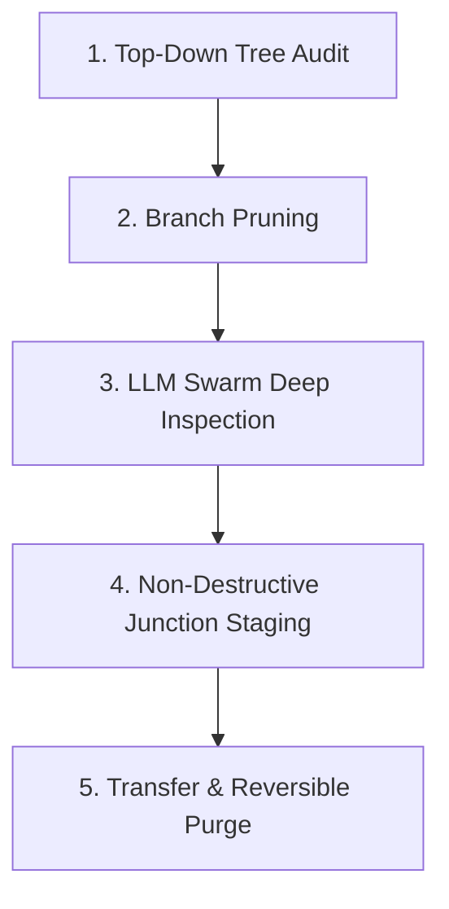

# System Content Segregation & Transfer Skill

A repeatable, forensic agent workflow for identifying, categorizing, staging, and transferring a secondary person's content (e.g. family member, client, or previous user) from a shared Windows computer to a new machine, followed by a verified clean purge.

---

## Why Pure Software Rules Fail

Naive scripts and filename regexes fail in real-world personal computers because:
1. **Generic / Disguised Names:** The most critical settlement, legal, and financial files often live in folders named `"New folder"` or `"temp"`, or files like `"Caregiver no experience.docx"` with zero family keywords in the name.
2. **Hidden Application Databases:** Crucial data resides in non-document databases: local Outlook/Hotmail `.ost` files, Chrome profile preferences, and SQLite chat stores.
3. **Internal Embedded Metadata:** The true owner is often recorded in Word XML `core.xml` (`creator`, `lastModifiedBy`), PDF metadata properties, or cloud sync service files (`ProfileServiceResponse.txt`), completely invisible to filename checks.

This skill relies on **top-down branch pruning** paired with an **autonomous LLM swarm** that inspects internal file contents, metadata, and databases.

---

## The 5-Phase Workflow



---

### Phase 1: Top-Down Tree Audit & High-Level Mapping

1. **Map Drive Volumes & Profiles:**
   * Query volume sizes: `Get-PSDrive -PSProvider FileSystem`.
   * Measure `C:\` root directories and `C:\Users\` profiles to identify where the gigabytes actually live.
2. **Ignore System Infrastructure (Do Not Touch):**
   * Skip `C:\Windows`, `C:\Program Files`, `C:\Program Files (x86)`, `C:\ProgramData`, `C:\$Recycle.Bin`, `C:\System Volume Information`.

---

### Phase 2: Hierarchical Branch Pruning

Before dispatching agents to micro-inspect thousands of files, evaluate directory nodes top-down:

1. **Clear-Cut User / Developer Trees:**
   * If a folder is exclusively developer work or personal gaming (e.g., `projects\`, `curseforge\`, `trading_bot\`, `.git\`, `node_modules\`), **prune the entire branch as `[USER BRANCH]`** immediately.
2. **Clear-Cut Secondary Target Trees:**
   * If a folder is unmistakably dedicated to the target person (e.g., `Phone Backup\iPhone-xxxx`, `1310132514\WPS云盘`, `Iphone13`), **prune the entire branch as `[TARGET BRANCH]`**.
3. **Mixed Libraries (Drill Down):**
   * Only descend into mixed roots: `Downloads\`, `Documents\`, `Desktop\`, and `OneDrive\`.

---

### Phase 3: Autonomous LLM Swarm Dispatch

Deploy parallel LLM subagents across the mixed zones. Instruct them to inspect file **internals**, not just filenames:

#### Agent Division of Labor:
* **Swarm Agent — Downloads Zone:**
  * Opens documents, reads bodies of PDFs and DOCX files.
  * Inspects archives (`.zip`) and separates user dev tools from target family records.
* **Swarm Agent — Cloud & Desktop Zone (`OneDrive` / `Desktop`):**
  * Opens generically named folders (`temp`, `New folder`).
  * Analyzes SQLite databases (e.g. distinguishing Discord exports from course lecture databases).
  * Evaluates STEM coursework, school applications, and immigration packets.
* **Swarm Agent — AppData & Profiles:**
  * Checks Chrome `Local State` for user profiles and account emails.
  * Checks Outlook/Hotmail offline `.ost` files and `Olk` attachments.
  * Identifies dedicated cloud sync clients (OneDrive, WPS Cloud, VooV/Zoom).

#### What Agents Must Inspect Inside Files:
```python
# 1. Word Document Embedded Properties
with zipfile.ZipFile(docx_path, 'r') as z:
    xml = z.read('docProps/core.xml')
    # Extracts <dc:creator> and <cp:lastModifiedBy>

# 2. PDF Metadata & First Pages
reader = pypdf.PdfReader(pdf_path)
meta = reader.metadata  # Author, Creator, Title

# 3. Chrome Profiles & Sync Accounts
# Read 'AppData\\Local\\Google\\Chrome\\User Data\\Local State'
# Extract profile emails and associated school/personal domains
```

---

### Phase 4: Non-Destructive Reparse Staging

> [!IMPORTANT]
> **Zero File Modification Rule:** Never move, alter, or delete original files during the audit.

Create a central staging directory on the desktop (e.g., `Desktop\Target_Data_Transfer`):

1. **For Whole Folder Branches:**
   * Use native **Windows Directory Junctions**:
     ```cmd
     cmd /c mklink /J "Staging\01_Phone_Backup" "C:\Phone Backup\iPhone-1979E7B4"
     ```
   * *Benefits:* Zero disk space used, instant creation, clicking into the junction in File Explorer transparently opens the real directory without copying gigabytes.
2. **For Standalone Files in Mixed Folders:**
   * Create standard `.lnk` Windows shortcuts pointing to the absolute path of the verified file.
3. **For Browser & Cloud Accounts:**
   * Export Chrome bookmarks to standard Netscape HTML format (`Mom_Chrome_Bookmarks.html`).
   * Include a text guide with connected email accounts and login instructions.

---

### Phase 5: Reversible Transfer & Confirmed Purge

Inside the staging folder, provide two automated scripts:

#### 1. Transfer Script (`Copy_Everything_To_USB_or_Folder.ps1`)
* Prompts user for a target destination (e.g., external USB drive `E:\`).
* Automatically iterates over all categories:
  * Resolves all `.lnk` shortcuts to their underlying target files and copies them.
  * Recursively copies all Directory Junction targets into real directories on the USB drive.

#### 2. Confirmed Deletion Script (`Delete_Originals_After_Transfer.ps1`)
* **Two-Phase Safety Guarantee:**
  * Only to be executed after the recipient confirms all files, photos, and bookmarks open correctly on the new machine.
  * Dynamically scans the transfer pack, lists every unique original path that will be purged, and requires typing `DELETE` in capital letters before removing anything.

---

## Standard Transfer Pack Structure

```
Target_Data_Transfer/
├── 01_Phone_Backups/                     [Directory Junction to iPhone backup]
├── 02_Mobile_Media_Photos_Videos/        [Directory Junction to photo/video dumps]
├── 03_Taxes_Banking_Financial/           [CRA T4, Notices of Assessment, Bank statements]
├── 04_Housing_Leases_Agreements/         [Tenancy agreements, move-out notices, utilities]
├── 05_Immigration_Legal_Dossiers/        [Work permits, passports, certified translations]
├── 06_Children_School_Admissions/        [School reports, registration records, forms]
├── 07_Career_Resumes_JobOffers/          [Resumes, foodsafe/caregiver certificates, job offers]
├── 08_Language_and_Adult_Education/      [CELPIP kits, textbooks, listening audios, ULI coursework]
├── 09_Email_Databases_and_Browser/       [Outlook OST databases, exported Chrome bookmarks HTML]
├── 10_Cloud_Drives_and_Photos/           [WPS Cloud sync directories, WeChat images]
├── 11_Downloads_Categorized_Files/       [Resolved standalone school & personal downloads]
├── Copy_Everything_To_USB_or_Folder.ps1  [Automated copy runner]
├── Delete_Originals_After_Transfer.ps1   [Guarded cleanup runner]
└── README_TRANSFER_GUIDE.txt             [User documentation]
```
